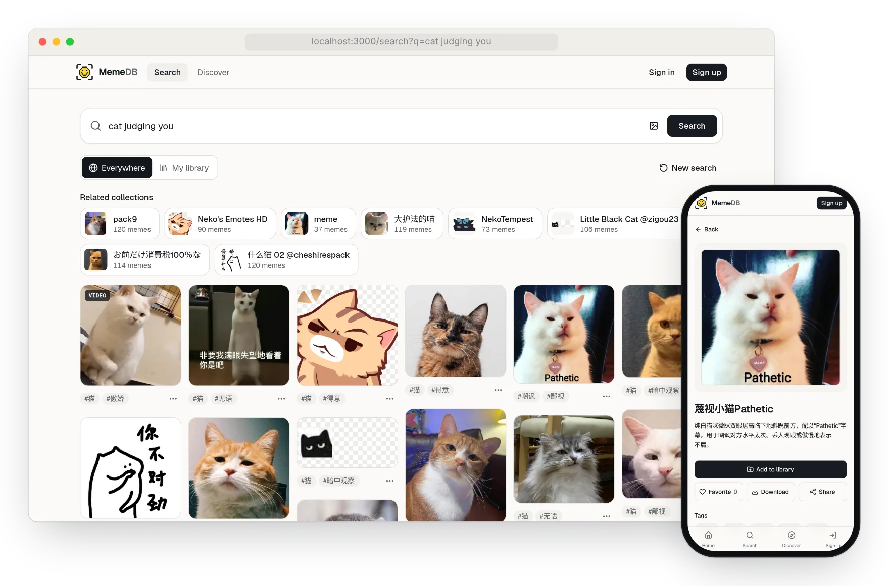
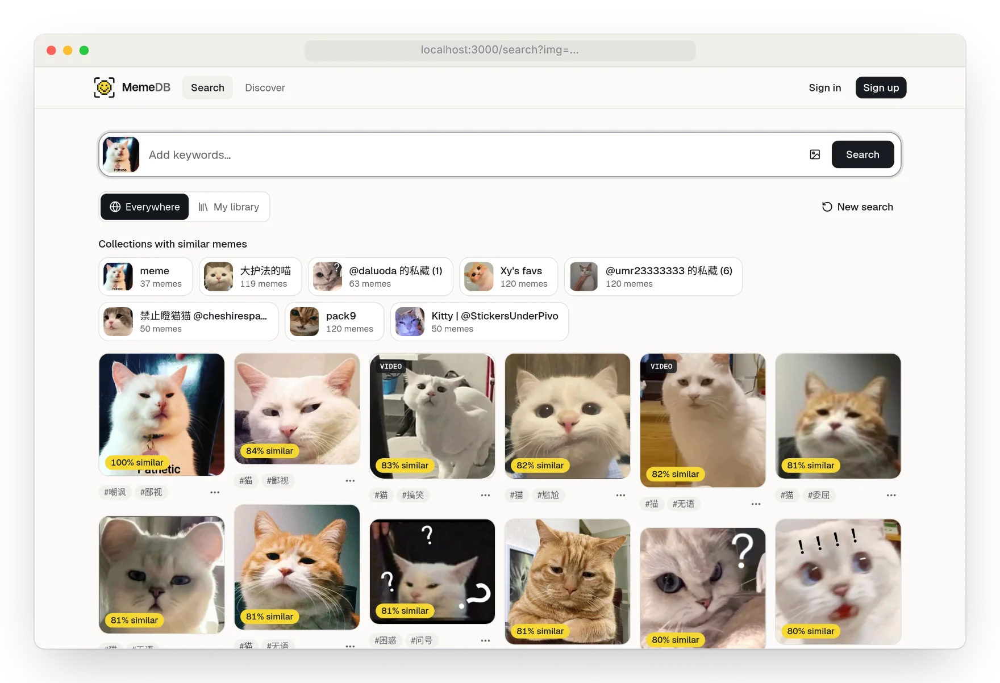
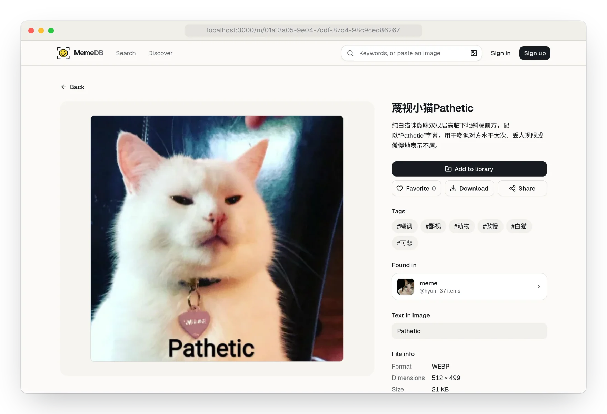
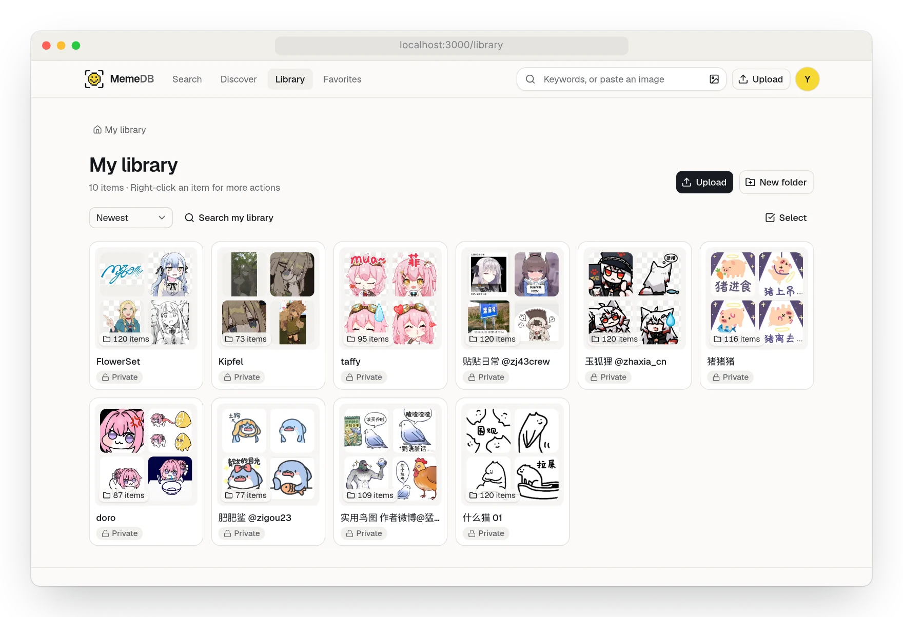
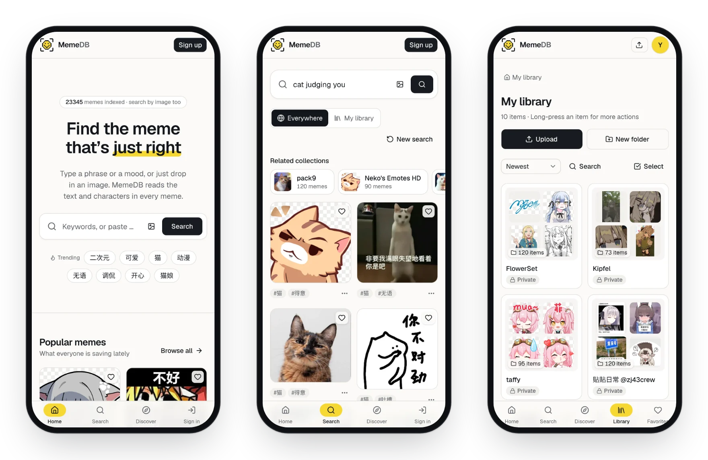
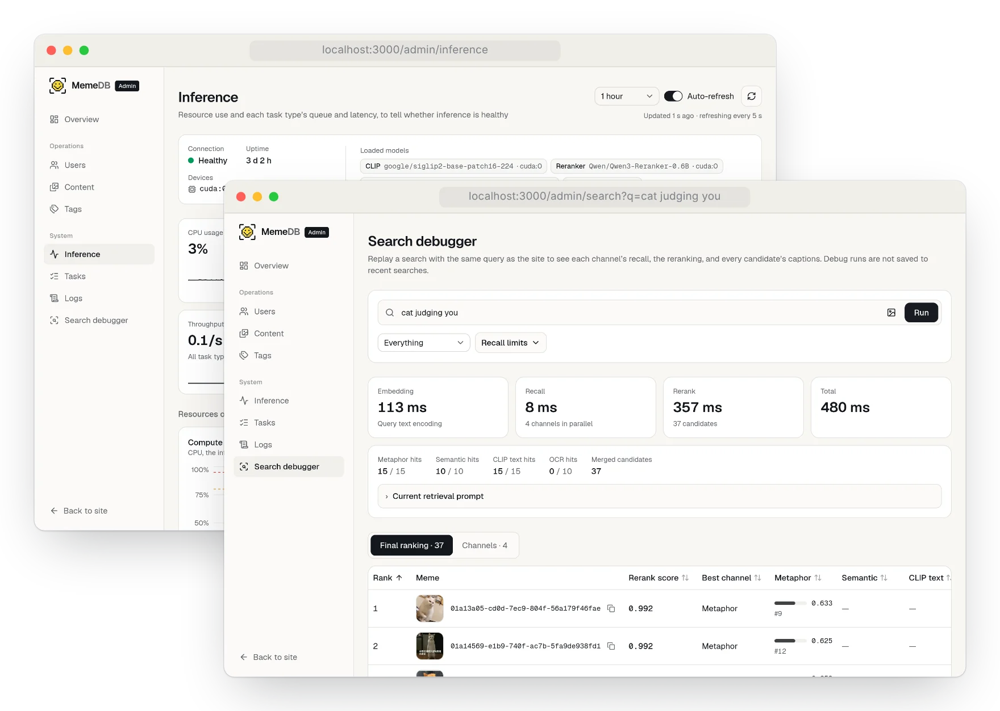
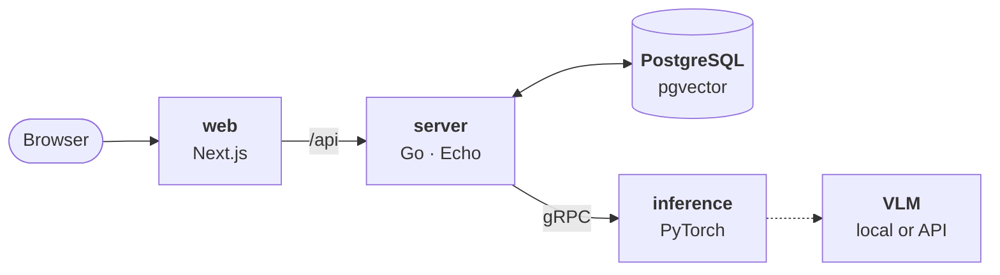

<p align="center">
  <picture>
    <source media="(prefers-color-scheme: dark)" srcset=".github/assets/logo-dark.svg">
    
  </picture>
</p>

<h1 align="center">MemeDB</h1>

<p align="center">
  <b>Find just the right meme, by words or by image.</b>
  <br>
  A self-hosted meme search engine that knows what memes mean, not just what they say.
</p>

<p align="center">
  <a href="#quick-start">Quick start</a>&nbsp;&nbsp;·&nbsp;&nbsp;<a href="#features">Features</a>&nbsp;&nbsp;·&nbsp;&nbsp;<a href="#how-it-works">How it works</a>&nbsp;&nbsp;·&nbsp;&nbsp;<a href="#development">Development</a>
  <br>
  <sub>English&nbsp;&nbsp;·&nbsp;&nbsp;<a href="README.zh-CN.md">简体中文</a></sub>
</p>

<br>

<picture>
  <source media="(prefers-color-scheme: dark)" srcset=".github/assets/hero-dark.webp">
  
</picture>

## Features

### Search by what a meme means

Ask for *cat judging you* and you get cats looking down on you, whatever words their captions use. Four channels recall candidates at once (the meme's meaning and the searches it answers, its description and tags, CLIP matching your words against the picture, and the text in the image), then a reranker reads each candidate's captions and puts the best first.

### Search by image

Paste, drop or pick an image to find memes that look like it, each scored by similarity, along with the collections that hold them.

<picture>
  <source media="(prefers-color-scheme: dark)" srcset=".github/assets/search-by-image-dark.webp">
  
</picture>

### Every meme, read closely

Each meme gets a title, a summary and tags in your language, the text found in it, and the similar memes beneath it. Add it to your library, favorite it, share it, or download it as it is or converted to PNG, JPG or GIF.

<picture>
  <source media="(prefers-color-scheme: dark)" srcset=".github/assets/meme-dark.webp">
  
</picture>

### A library of your own

Upload images, GIFs, videos and Lottie stickers, Telegram's included, and sort them into folders. Keep them private, make a folder public or share it by a private link, save the collections others share, and search just your own memes.

<picture>
  <source media="(prefers-color-scheme: dark)" srcset=".github/assets/library-dark.webp">
  
</picture>

### At home on a phone

Every page works as well on a phone as on a desktop, in light and dark, in Chinese and English: whichever your browser prefers, or the one you pick in the footer.

<picture>
  <source media="(prefers-color-scheme: dark)" srcset=".github/assets/phones-dark.webp">
  
</picture>

### An admin console that shows its work

Watch the inference service's resources, queues and latency; replay any search to see what each channel recalled and how the reranker scored it; and look after users, content, tags, tasks and logs.

<picture>
  <source media="(prefers-color-scheme: dark)" srcset=".github/assets/admin-dark.webp">
  
</picture>

### An API for scripts and bots

Personal API tokens let scripts search, upload and organize as you; the site's `/developers` page documents every endpoint.

```sh
curl -H "Authorization: Bearer $MEMEDB_TOKEN" -F "file=@doge.gif" -F "path=Imported" \
  http://localhost:3000/api/library/upload
```

## How it works



An upload joins a task queue in Postgres. A worker has the inference service caption the meme with a vision language model, then embeds the picture with CLIP and the captions with a text model, and the meme becomes searchable. A search embeds the query once, recalls from every channel in parallel, merges what they find and reranks it a page at a time.

| Project | Stack | Role |
| --- | --- | --- |
| [server](server/) | Go, Echo, PostgreSQL + pgvector | The API: accounts, libraries, storage, search, and the task queue that ingests memes |
| [inference](inference/) | Python, PyTorch, gRPC | VLM captions, CLIP and text embeddings, reranking |
| [web](web/) | Next.js, React | The site and the admin console |
| [protos](protos/) | Protobuf | The gRPC contract between server and inference |

## Quick start

Docker Compose runs all of it:

```sh
git clone https://github.com/hyunel/meme-db.git && cd meme-db
cp .env.example .env   # Fill in your OpenAI-compatible VLM provider
docker compose up -d
```

Open http://localhost:3000. The first start builds inference and downloads its model weights, which can take a while; the server waits for it.

Inference runs on the CPU by default. To keep searches quick there, uncomment the smaller models in `inference/models.yaml`. Do this before adding memes: changing the embedding model later means re-embedding every meme.

To use a GPU instead, uncomment the matching `COMPOSE_FILE` line in `.env` (the first for NVIDIA, the second for Intel). Compose then builds inference with the right PyTorch and runs the models on the GPU.

Accounts start as users. To make yours an admin after signing up:

```sh
docker compose exec server memedb user role <username> admin
```

> [!NOTE]
> The VLM captions every meme uploaded or reprocessed, so with a paid API each one costs money.

### Configuration

Settings come from files in the checkout, which Compose mounts:

- **`inference/models.yaml`** picks the models. By default captions come from the VLM API in `.env`, and the other models run on the GPU if there is one; its comments show a local VLM and smaller models for the CPU. After a change, `docker compose restart inference`. The server re-embeds every meme when the CLIP or text embedding model changes.
- **`server/config.docker.yaml`** overrides the [server's settings](server/README.md#configuration), such as the language of captions or S3 storage. After a change, `docker compose restart server`.

## Development

Each project's README explains how to run it on its own; `make dev-server`, `make dev-ai` and `make dev-web` start them. After editing `protos/`, run `make gen-proto` to regenerate the Go and Python code.
