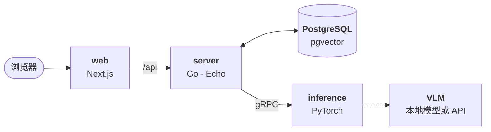

<p align="center">
  <picture>
    <source media="(prefers-color-scheme: dark)" srcset=".github/assets/logo-dark.svg">
    
  </picture>
</p>

<h1 align="center">MemeDB</h1>

<p align="center">
  <b>用文字或图片，找到那张刚刚好的表情包。</b>
  <br>
  一个可以自己部署的表情包搜索引擎，读得懂表情包的真正内涵。
</p>

<p align="center">
  <a href="#快速开始">快速开始</a>&nbsp;&nbsp;·&nbsp;&nbsp;<a href="#功能">功能</a>&nbsp;&nbsp;·&nbsp;&nbsp;<a href="#工作原理">工作原理</a>&nbsp;&nbsp;·&nbsp;&nbsp;<a href="#开发">开发</a>
  <br>
  <sub><a href="README.md">English</a>&nbsp;&nbsp;·&nbsp;&nbsp;简体中文</sub>
</p>

<br>

<picture>
  <source media="(prefers-color-scheme: dark)" srcset=".github/assets/hero-dark.webp">
  
</picture>

## 功能

### 按意思搜索

搜「cat judging you」，找到的就是一群居高临下打量你的猫，不管它们的配文怎么写，中文、英文或别的语言都能搜。四路召回同时进行：表情包的含义和它能回答的搜索词、画面描述和标签、CLIP 用文字去匹配画面，以及图中的文字。随后重排模型读完每个候选的识别结果，把最贴切的排在前面。

### 以图搜图

粘贴、拖入或选择一张图片，就能找到和它相似的表情包，每张都标出相似度，并列出收录它们的合集。

<picture>
  <source media="(prefers-color-scheme: dark)" srcset=".github/assets/search-by-image-dark.webp">
  
</picture>

### 每张表情包都被认真读过

每张表情包都有用你的语言写成的标题、说明和标签，有识别出的图中文字，下方还有相似的表情包。可以把它加入自己的库、收藏、分享，或者按原格式下载，也能转成 PNG、JPG、GIF。

<picture>
  <source media="(prefers-color-scheme: dark)" srcset=".github/assets/meme-dark.webp">
  
</picture>

### 属于你的库

上传图片、GIF、视频和 Lottie 贴纸（包括 Telegram 贴纸），用文件夹整理。默认私有，也可以公开某个文件夹，或者用私密链接分享；还能把别人分享的合集存进自己的库，只在自己的表情包里搜索。

<picture>
  <source media="(prefers-color-scheme: dark)" srcset=".github/assets/library-dark.webp">
  
</picture>

### 手机上一样好用

每个页面在手机和电脑上都一样好用，支持浅色和深色，支持中文和英文：默认跟随浏览器，也可以在页脚切换。

<picture>
  <source media="(prefers-color-scheme: dark)" srcset=".github/assets/phones-dark.webp">
  
</picture>

### 看得见过程的管理后台

查看推理服务的资源、队列和延迟；复现任意一次搜索，看每一路召回了什么、重排模型怎样打分；也在这里管理用户、内容、标签、任务和日志。

<picture>
  <source media="(prefers-color-scheme: dark)" srcset=".github/assets/admin-dark.webp">
  
</picture>

### 给脚本和机器人的 API

个人 API 令牌让脚本以你的身份搜索、上传和整理表情包；站点的 `/developers` 页面列出了全部接口。

```sh
curl -H "Authorization: Bearer $MEMEDB_TOKEN" -F "file=@doge.gif" -F "path=自动入库" \
  http://localhost:3000/api/library/upload
```

## 工作原理



上传的表情包会进入 Postgres 里的任务队列。工作进程先让推理服务用视觉语言模型识别它，再用 CLIP 为画面、用文本模型为识别结果生成向量，之后它就能被搜到了。一次搜索只把查询向量化一次，各路并行召回，合并结果后按页重排。

| 项目 | 技术栈 | 职责 |
| --- | --- | --- |
| [server](server/) | Go、Echo、PostgreSQL + pgvector | API：账号、库、存储、搜索，以及处理入库的任务队列 |
| [inference](inference/) | Python、PyTorch、gRPC | VLM 识别、CLIP 和文本向量、重排 |
| [web](web/) | Next.js、React | 站点和管理后台 |
| [protos](protos/) | Protobuf | server 与 inference 之间的 gRPC 协议 |

## 快速开始

Docker Compose 可以一键运行全部服务：

```sh
git clone https://github.com/hyunel/meme-db.git && cd meme-db
cp .env.example .env   # 填入你的 OpenAI 兼容 VLM 服务
docker compose up -d
```

打开 http://localhost:3000。首次启动要构建推理服务并下载模型权重，可能需要一段时间，server 会等它就绪。

推理服务默认在 CPU 上运行。为了让搜索更快，建议取消注释 `inference/models.yaml` 里较小的模型。请在添加表情包之前完成这一步，因为之后更换向量模型，需要为所有表情包重新计算向量。

如果有 GPU，在 `.env` 里取消注释对应的 `COMPOSE_FILE` 一行（第一行是 NVIDIA，第二行是 Intel）。Compose 会用对应的 PyTorch 构建推理服务，让模型在 GPU 上运行。

新注册的账号都是普通用户。注册后，用下面的命令把自己设为管理员：

```sh
docker compose exec server memedb user role <你的用户名> admin
```

> [!NOTE]
> 每张上传或重新处理的表情包都要经过 VLM 识别，使用付费 API 时每张都会产生费用。

### 配置

配置来自代码目录里的文件，Compose 会把它们挂载进容器：

- **`inference/models.yaml`** 选择模型。默认用 `.env` 里的 VLM API 识别，其余模型有 GPU 时跑在 GPU 上；文件注释里有本地 VLM 和适合 CPU 的小模型。修改后执行 `docker compose restart inference`。换了 CLIP 或文本向量模型时，server 会自动重建所有表情包的向量。
- **`server/config.docker.yaml`** 覆盖 [server 的配置](server/README.md#configuration)，比如识别结果的语言或 S3 存储。修改后执行 `docker compose restart server`。

## 开发

每个子项目的 README 说明了如何单独运行它；`make dev-server`、`make dev-ai` 和 `make dev-web` 分别启动它们。修改 `protos/` 之后，执行 `make gen-proto` 重新生成 Go 和 Python 代码。
